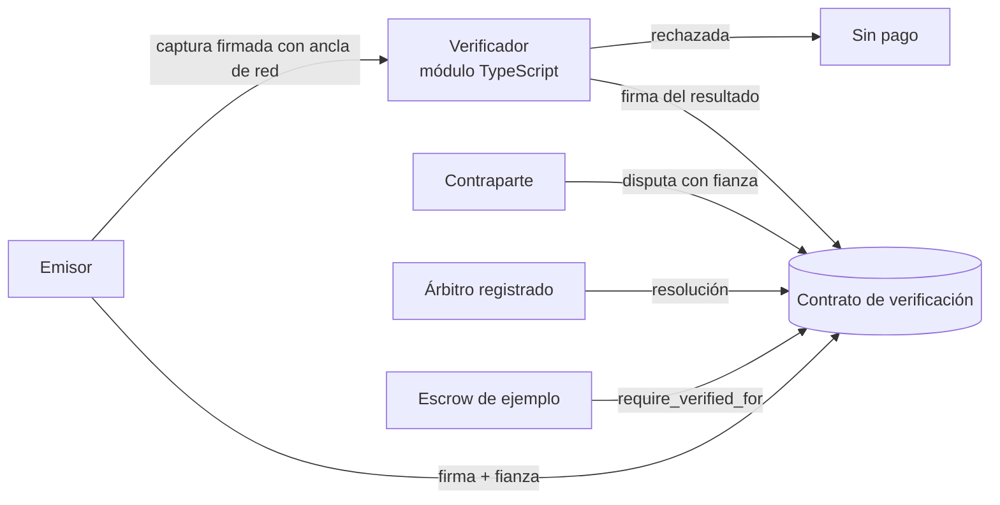

# Arquitectura

## Componentes
| Componente | Entorno | Responsabilidad | Estado |
|---|---|---|---|
| Contrato de verificación ([código](../contracts/verificacion/src/lib.rs)) | Testnet | Roles, política por nivel, fianza proporcional, plazo, disputa y consulta | Implementado y desplegado |
| Escrow de ejemplo ([código](../contracts/escrow-ejemplo/src/lib.rs)) | Testnet | Consulta el contrato de verificación antes de liberar un pago | Implementado y desplegado |
| Módulo de verificación (TypeScript) | Verificador, fuera de la red | Reglas bloqueantes y cálculo determinista del ICE | Pendiente |
| Página de captura (web) | Dispositivo del emisor | Toma la imagen, calcula las huellas, incluye el ancla de red y firma el registro | Pendiente |

Los contratos están escritos en Rust con `soroban-sdk` 30. IDs y transacciones: [evidencia/TESTNET.md](evidencia/TESTNET.md).

## Interfaz del contrato de verificación
| Función | Quién firma | Descripción |
|---|---|---|
| `register_issuer(issuer)` | Admin | Alta de emisor |
| `register_verifier(verifier)` | Admin | Alta de verificador |
| `register_arbiter(arbiter)` | Admin | Alta de árbitro |
| `set_policy(level, policy)` | Admin | Política de un nivel: ICE mínimo, plazo, `k` y fianza mínima |
| `submit(hash, issuer, verifier, amount, level, result, anchor_ledger)` | Emisor y verificador | Registra la evidencia y retiene la fianza. Falla si las dos cuentas son la misma, si el ICE es menor al mínimo del nivel, si el ancla está fuera de margen o si la huella ya se envió |
| `dispute(hash, challenger)` | Quien disputa | Deposita una fianza igual. Solo con el plazo abierto |
| `resolve(hash, arbiter, valid)` | Árbitro | El árbitro no puede ser parte. Quien gana recibe las dos fianzas |
| `finalize(hash)` | Nadie | Vencido el plazo sin disputa, marca la evidencia como verificada y devuelve la fianza |
| `require_verified(hash, min_level) -> bool` | Nadie | `true` solo si la evidencia está verificada con ese nivel o uno mayor |
| `require_verified_for(hash, issuer, min_level, min_amount) -> bool` | Nadie | Además exige que la evidencia sea de `issuer` y por un monto igual o mayor. Es la consulta que tiene que usar un escrow |
| `get(hash)`, `get_policy(level)` | Nadie | Lectura |

`result` contiene el ICE en puntos básicos, la huella de las señales y la versión de reglas.

`require_verified_for` existe para que una evidencia verificada por un monto chico, con una fianza chica, no habilite un pago grande.

## Diferencias con el marco
El contrato implementa una versión reducida de [MARCO-DE-VERIFICACION.md](MARCO-DE-VERIFICACION.md):

| En el marco | En el contrato |
|---|---|
| Verificador y árbitro con depósito | Se registran sin depósito |
| Disputa de cálculo y disputa de hecho | Un solo tipo de disputa, que resuelve el árbitro |
| Comisión del árbitro | No hay comisión |
| El ancla es el hash de un ledger | El contrato comprueba que el número de ledger sea reciente. El hash lo tiene que comprobar el verificador fuera de la red |
| Captura firmada obligatoria en los niveles medio y alto | No se comprueba en el contrato |

## Decisiones pendientes
- Almacenamiento de la imagen fuera de la red y acceso de las partes durante el plazo.
- Biblioteca para la huella perceptual y umbral de similitud.
- Cómo liga un escrow la evidencia con un hito concreto. Hoy una misma evidencia podría usarse en dos escrows del mismo beneficiario.
