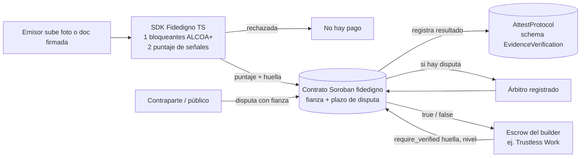

# Arquitectura propuesta (sin implementar)

## Piezas
| Pieza | Dónde corre | Responsabilidad |
|---|---|---|
| SDK `@fidedigno/sdk` (TypeScript) | Fuera de la red | Huella SHA-256 y perceptual, lectura de EXIF y C2PA, bloqueantes, puntaje y armado del resultado |
| Contrato `fidedigno` (Rust/Soroban) | Testnet | Recibe el resultado, aplica la tabla GAMP 5, maneja fianzas y plazos, resuelve disputas y expone `require_verified` |
| AttestProtocol (externo) | Testnet / Mainnet | Registro público del resultado como atestación |
| Crate `fidedigno` (Rust) | Dentro del contrato del builder | Interfaz mínima para llamar a `require_verified` |
| Escrow de ejemplo | Testnet | Libera el hito solo con evidencia verificada |
| Verificador web | Navegador | Consulta pública de una huella: puntaje, estado y disputas |

## Interfaz del contrato `fidedigno` (borrador)
- `register_issuer(issuer)` y `register_arbiter(arbiter)`: altas, solo el admin.
- `set_policy(level, high_cut, low_cut, window_secs, bond)`: tabla GAMP 5 versionada.
- `submit(hash, score, signals_hash, rules_version, level, issuer)`: exige la firma del emisor y deposita la fianza. Si `score < low_cut`, falla.
- `dispute(hash, challenger)`: exige la fianza del que disputa y que el plazo esté abierto.
- `resolve(hash, arbiter, valid: bool)`: el árbitro tiene que ser distinto del emisor; paga las fianzas.
- `finalize(hash)`: si venció el plazo sin disputa, marca "verificada" y devuelve la fianza.
- `require_verified(hash, min_level) -> bool`: verdadero solo si está "verificada" (falla cerrada).

## Decisiones pendientes (G0)
- Almacenamiento del archivo fuera de la red: IPFS o un servidor del builder.
- Token de la fianza en Testnet: USDC de prueba o un token propio de prueba.
- Si AttestProtocol permite un *resolver* propio y cuánto cuesta atestar.
- Cómo guarda Trustless Work la evidencia del hito, para el adaptador.
