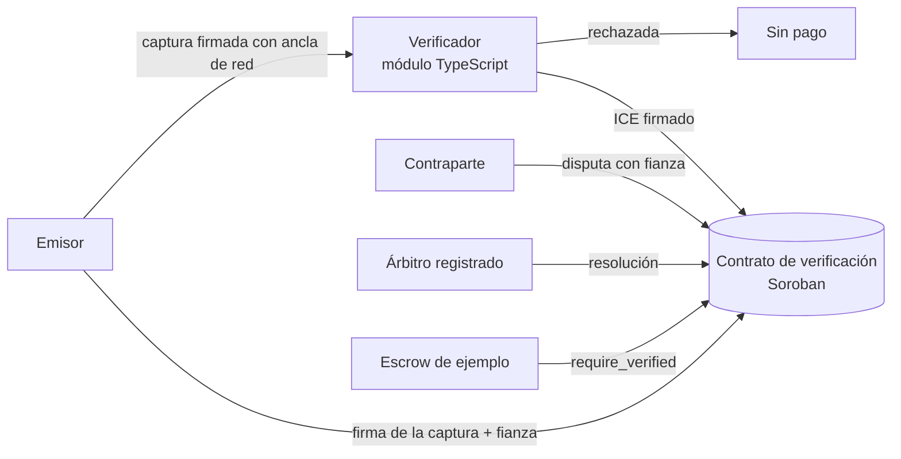

# Arquitectura

> Propuesta para el prototipo. No hay nada implementado todavía.

## Componentes
| Componente | Entorno | Responsabilidad |
|---|---|---|
| Página de captura (web) | Dispositivo del emisor | Toma la imagen, calcula las huellas, incluye el ancla de red y firma el registro |
| Módulo de verificación (TypeScript) | Verificador, fuera de la red | Reglas bloqueantes y cálculo determinista del ICE |
| Contrato de verificación (Rust/Soroban) | Testnet | Roles, política por nivel, fianza proporcional, plazo, disputas y consulta |
| Escrow de ejemplo (Rust/Soroban) | Testnet | Consulta `require_verified` antes de liberar un pago |

Fuera del prototipo: varios verificadores con quórum, panel de árbitros, calibración de la tabla de señales y una interfaz web de consulta.

## Interfaz del contrato (borrador)
| Función | Descripción |
|---|---|
| `register_issuer(issuer)` | Alta de emisor (solo el admin) |
| `register_verifier(verifier, stake)` | Alta de verificador con depósito |
| `register_arbiter(arbiter, stake)` | Alta de árbitro con garantía |
| `set_policy(level, min_ice, capture_required, window_secs, k, min_bond)` | Política por nivel de riesgo, versionada |
| `submit(hash, capture, amount, level, issuer, result, verifier)` | Requiere la firma del emisor y la del verificador, que tienen que ser cuentas distintas. Comprueba el margen del ancla, calcula la fianza con el ICE y el monto, y la deposita. Falla si el ICE es menor al mínimo del nivel |
| `dispute(hash, challenger, kind)` | Requiere una fianza igual y que el plazo esté abierto. `kind` es de cálculo o de hecho |
| `resolve(hash, arbiter, valid)` | El árbitro no puede ser parte. Distribuye las fianzas y, en una disputa de cálculo perdida, descuenta el depósito del verificador |
| `finalize(hash)` | Vencido el plazo sin disputa, marca la evidencia como verificada y devuelve la fianza |
| `require_verified(hash, min_level) -> bool` | Devuelve `true` solo si la evidencia está verificada |

`result` contiene el ICE en puntos básicos, la huella de las señales y la versión de reglas.

## Decisiones pendientes
- Almacenamiento de la imagen fuera de la red y acceso de las partes durante el plazo.
- Token de prueba para fianzas y depósitos.
- Biblioteca para la huella perceptual y umbral de similitud.
- Margen de ledgers permitido entre el ancla y el envío.
