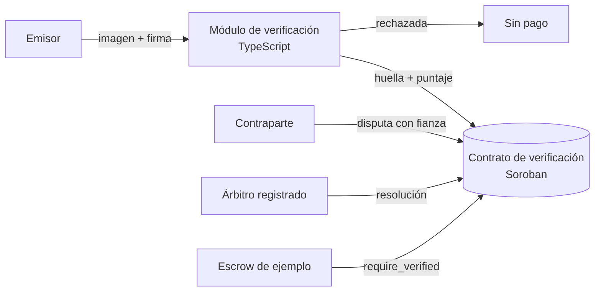

# Arquitectura

> Propuesta para el prototipo. No hay nada implementado todavía.

## Componentes
| Componente | Entorno | Responsabilidad |
|---|---|---|
| Módulo de verificación (TypeScript) | Fuera de la red | Huellas SHA-256 y perceptual, lectura de EXIF y C2PA, reglas bloqueantes y puntaje |
| Contrato de verificación (Rust/Soroban) | Testnet | Política por nivel de riesgo, fianzas, plazo de disputa, resolución y consulta |
| Escrow de ejemplo (Rust/Soroban) | Testnet | Consulta `require_verified` antes de liberar un pago |

Fuera del prototipo: publicar los resultados en AttestProtocol, una librería Rust para terceros y una interfaz web de consulta.

## Interfaz del contrato (borrador)
| Función | Descripción |
|---|---|
| `register_issuer(issuer)` | Alta de emisor (solo el admin) |
| `register_arbiter(arbiter)` | Alta de árbitro (solo el admin) |
| `set_policy(level, high_cut, low_cut, window_secs, bond)` | Política por nivel de riesgo, versionada |
| `submit(hash, score, signals_hash, rules_version, level, issuer)` | Requiere la firma del emisor y deposita la fianza. Falla si `score < low_cut` |
| `dispute(hash, challenger)` | Requiere una fianza y que el plazo esté abierto |
| `resolve(hash, arbiter, valid)` | El árbitro tiene que ser distinto del emisor. Distribuye las fianzas |
| `finalize(hash)` | Vencido el plazo sin disputa, marca la evidencia como verificada y devuelve la fianza |
| `require_verified(hash, min_level) -> bool` | Devuelve `true` solo si la evidencia está verificada |

## Decisiones pendientes
- Almacenamiento de la imagen fuera de la red.
- Token de prueba para las fianzas.
- Biblioteca para la huella perceptual y la lectura de C2PA en TypeScript.
